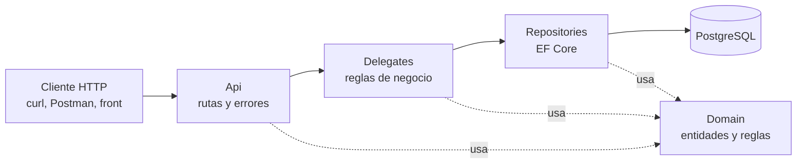
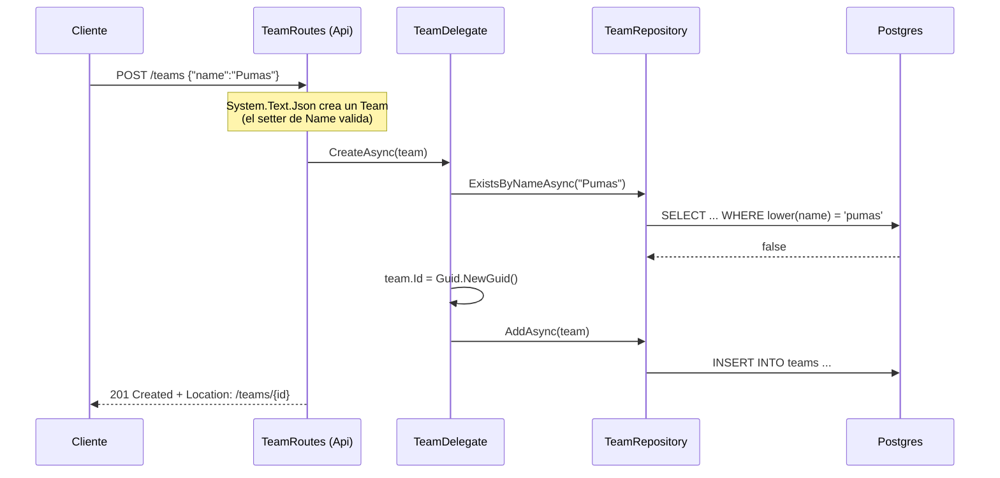
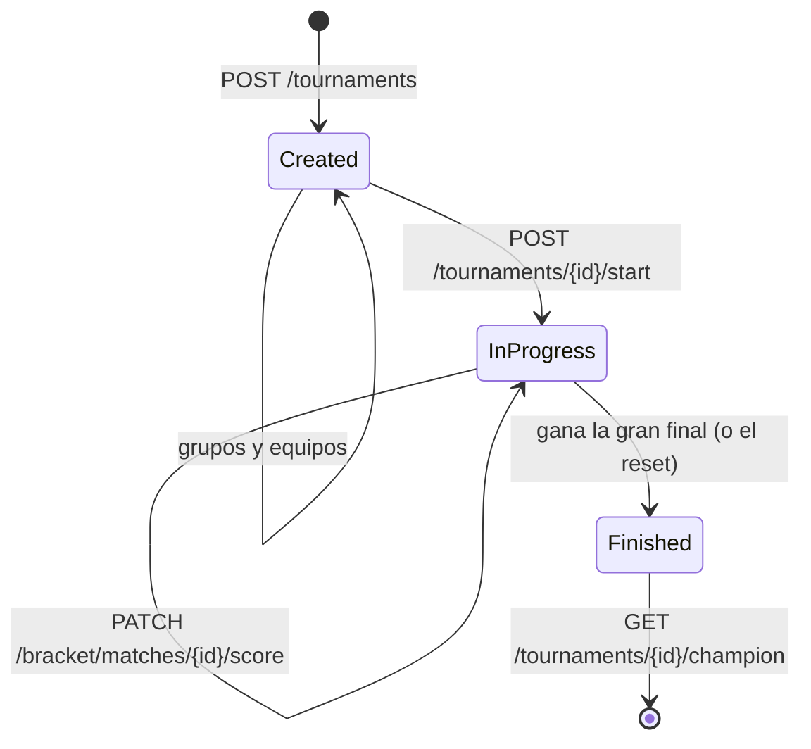

# TournamentServices

API REST para administrar torneos: equipos, torneos, grupos y partidos. Su pieza principal es el formato de **doble eliminación**: la API arma el bracket, decide quién juega contra quién después de cada resultado y declara al campeón.

Está hecha en **C# / .NET 10** con **Minimal APIs**, **EF Core** y **PostgreSQL**, y corre en un **dev container** de Podman.

Este README va de lo simple a lo complejo. Cada nivel termina con una pregunta de repaso: si no puedes contestarla con tus palabras, vuelve a leer ese nivel antes de seguir.

- [Mapa del repositorio](#mapa-del-repositorio)
- [Nivel 1. Las cuatro capas](#nivel-1-las-cuatro-capas)
- [Nivel 2. El dominio](#nivel-2-el-dominio)
- [Nivel 3. Un request de punta a punta](#nivel-3-un-request-de-punta-a-punta)
- [Nivel 4. Persistencia: EF Core y Postgres](#nivel-4-persistencia-ef-core-y-postgres)
- [Nivel 5. La doble eliminación](#nivel-5-la-doble-eliminación)
- [Endpoints](#endpoints)
- [Cómo correrlo](#cómo-correrlo)
- [Las pruebas](#las-pruebas)
- [Decisiones y deuda conocida](#decisiones-y-deuda-conocida)
- [Mini-retos](#mini-retos)

---

## Mapa del repositorio

```
tournament_double_elimination/
├── src/
│   ├── TournamentServices.Api/            # HTTP: rutas, filtros, manejo de errores, DI
│   ├── TournamentServices.Delegates/      # Reglas de negocio que coordinan varias entidades
│   ├── TournamentServices.Repositories/   # Acceso a datos con EF Core (DbContext + repositorios)
│   └── TournamentServices.Domain/         # Entidades, reglas propias, excepciones y el bracket
├── tests/
│   ├── TournamentServices.Domain.Tests/        # Unitarias puras (sin base, sin mocks)
│   ├── TournamentServices.Delegates.Tests/     # Unitarias con Moq
│   ├── TournamentServices.Repositories.Tests/  # EF Core InMemory
│   ├── TournamentServices.Api.Tests/           # HTTP completo (InMemory y Postgres real)
│   └── TournamentServices.TestBuilders/        # Builders para armar datos de prueba
├── database/init/db_script.sql   # Esquema real de Postgres (lo corre el contenedor al crear el volumen)
├── docker-compose.dev.yml        # Postgres + contenedor de desarrollo
├── .devcontainer/                # Configuración de VS Code Dev Containers
└── PRUEBAS.md                    # Guía práctica para levantar y probar
```

---

## Nivel 1. Las cuatro capas

La idea más importante del proyecto es que **cada capa solo conoce a la de abajo**:



| Capa | Responde a la pregunta | Ejemplo real |
| --- | --- | --- |
| **Api** | ¿Qué URL es y qué código HTTP regreso? | `POST /teams` regresa `201 Created` |
| **Delegates** | ¿Se puede hacer esto según las reglas del negocio? | No se puede crear un equipo con un nombre que ya existe |
| **Repositories** | ¿Cómo lo guardo o lo leo de la base? | `TeamRepository.ExistsByNameAsync` |
| **Domain** | ¿Qué es un equipo y qué reglas cumple siempre? | Un `Team` nunca tiene nombre vacío |

**Domain no depende de nadie.** No sabe que existe HTTP ni EF Core. Por eso sus pruebas son las más rápidas y simples.

**Conexión con arquitectura de software:** esto es una *arquitectura en capas*. Es pariente de *Clean Architecture*, donde el dominio queda en el centro. La ventaja es que puedes cambiar Postgres por otra base y solo tocas Repositories.

**Conexión con KORA:** en Razor Pages tu `PageModel` hace a la vez lo que aquí hacen Api y Delegates. Aquí están separados para poder probar las reglas sin levantar un servidor.

Las capas se conectan con **inyección de dependencias** en `Api/Middleware/Servicecollectionextensions.cs`. Ahí se registra cada interfaz con su clase (`ITeamDelegate` → `TeamDelegate`, `ITeamRepository` → `TeamRepository`…), todas como `Scoped`, es decir, una instancia nueva por cada request.

> **Repaso 1:** si mañana el PRD dice "los nombres de equipo deben tener al menos 3 letras", ¿en qué capa pondrías esa regla y por qué no en la Api?

---

## Nivel 2. El dominio

### Entidades

| Clase | Qué representa | Reglas que protege |
| --- | --- | --- |
| `Team` | Un equipo | Nombre no vacío (se guarda sin espacios a los lados) |
| `Tournament` | Un torneo | Nombre no vacío, formato requerido, `Start()` y `Finish()` (ver nivel 5) |
| `Group` | Un grupo dentro de un torneo | Nombre no vacío, no repetir equipos (`AddTeam`, `RemoveTeam`) |
| `Match` | Un partido | Local y visitante requeridos y distintos; `SetScore()` calcula `Winner` |

Las reglas viven en los **setters** y en los métodos. Por ejemplo, `team.Name = ""` lanza `DomainValidationException`. Un objeto de dominio nunca puede quedar en un estado inválido.

### Value objects

`Score` y `TournamentFormat` son `record`: no tienen identidad propia, valen por su contenido. Dos `Score(2, 1)` son iguales aunque sean objetos distintos, y por eso los tests pueden hacer `Assert.Equal(new TournamentFormat(4, 2, RoundRobin), dto.Format)`.

**Conexión con POO:** esto es *encapsulamiento*. En vez de validar en mil lugares, el objeto se valida a sí mismo.

### Excepciones y su código HTTP

El dominio y los delegates **lanzan excepciones con significado**, y `Api/Middleware/Globalexceptionhandler.cs` las traduce a HTTP en un solo lugar:

| Excepción | HTTP | Cuándo se usa |
| --- | --- | --- |
| `DomainValidationException` | 400 | El dato está mal formado (nombre vacío, marcador negativo) |
| `DuplicateNameException` | 400 | Nombre repetido de equipo o torneo (lo pide el PRD) |
| `NotFoundException` | 404 | No existe el recurso |
| `BusinessRuleException` | 422 | El dato está bien, pero la regla no lo permite (grupo lleno, empate en eliminación) |
| `JsonException` / `BadHttpRequestException` | 400 | El JSON no se pudo leer |
| `DbUpdateException` | 409 | Choque en la base (índice único) |
| Cualquier otra | 500 | Error no esperado (se registra en el log) |

La diferencia entre **400** y **422** es clave: 400 significa "tu petición está mal escrita", y 422 significa "está bien escrita, pero no tiene sentido ahora". `DuplicateNameException` hereda de `BusinessRuleException`, pero el `switch` del handler la revisa antes, por eso regresa 400.

> **Repaso 2:** un cliente manda `{"homeTeamScore": 1, "visitorTeamScore": 1}` a un partido del bracket. ¿Qué excepción se lanza, en qué capa y qué código HTTP recibe? Pista: el empate es válido en Round Robin.

---

## Nivel 3. Un request de punta a punta

Seguimos `POST /teams` con `{"name": "Pumas"}`:



Si el nombre ya existe, `TeamDelegate` lanza `DuplicateNameException`. Nadie la atrapa en el camino, sube hasta `GlobalExceptionHandler` y el cliente recibe un **400** con formato *ProblemDetails*:

```json
{ "title": "Bad Request", "status": 400, "detail": "Ya existe un equipo con el nombre 'Pumas'." }
```

Dos piezas más que corren en cada request:

- **`ValidateIdFilter`:** revisa que todo parámetro de ruta que termine en `Id` cumpla `^[A-Za-z0-9\-]+$`. Si no, regresa 400 sin llegar al delegate.
- **JSON:** se usa camelCase y los enums salen como texto en `SNAKE_CASE_UPPER` (`RoundRobin` → `"ROUND_ROBIN"`, `Home` → `"HOME"`). Se configura en `Program.cs`.

> **Repaso 3:** ¿por qué `GET /teams/abc$def` responde 400 y `GET /teams/no-existe` responde 404, si ninguno de los dos existe?

---

## Nivel 4. Persistencia: EF Core y Postgres

### El mapeo (`Repositories/TournamentDbContext.cs`)

EF Core traduce las clases del dominio a tablas. Algunas decisiones importantes:

| Qué | Cómo se mapea | Por qué |
| --- | --- | --- |
| `Tournament.Format` | *Owned type*: columnas `max_teams_per_group`, `number_of_groups`, `format_type` en la misma tabla | Es un value object, no merece tabla propia |
| `Match.Score` | *Owned type*: `home_team_score`, `visitor_team_score` | Igual |
| Enums | `HasConversion<string>()` → se guardan como texto (`"Home"`, `"Finished"`) | Legible en la base y no se rompe si cambia el orden del enum |
| `Group.TeamIds` | **Ignorado** por EF; vive en la tabla puente `group_teams` | Relación muchos a muchos: un equipo puede estar en grupos de distintos torneos |
| `Tournament.SeededTeamIds` | Columna `text[]` (arreglo nativo de Postgres) | El orden sorteado del bracket (nivel 5) |

**Conexión con bases de datos:** `group_teams` es una *tabla intermedia* de una relación N:M, como las que normalizas en la materia. `GroupRepository` la llena a mano en `AddAsync`/`UpdateAsync` y la lee en `LoadTeamIdsAsync`.

### Soft delete

Nada se borra de verdad. Cada tabla tiene una columna `deleted_at`, y "borrar" es ponerle la fecha con `ExecuteUpdateAsync`. Un **query filter** global (`HasQueryFilter(e => deleted_at == null)`) hace que EF ignore esas filas en todas las consultas.

Por eso los índices únicos son **parciales** (`WHERE deleted_at IS NULL`): puedes crear otro equipo "Pumas" si el anterior fue borrado.

Una consecuencia práctica: **EF InMemory no soporta `ExecuteUpdateAsync`**, así que el borrado solo se prueba contra Postgres real.

### Dos fuentes del esquema, y por qué importan

1. **`database/init/db_script.sql`:** es el esquema real. Lo corre Postgres **una sola vez**, cuando se crea el volumen `tournament_pgdata`.
2. **El modelo de EF** (`TournamentDbContext`): es lo que EF *cree* que hay en la base.

Si no coinciden, la API truena en tiempo de ejecución. Pasó de verdad: el script tenía ids `UUID` y EF manda `text`, así que no se podía guardar nada. Hoy los ids son `TEXT`, y las pruebas de Postgres crean su base **con el script** para detectar cualquier diferencia.

> **Repaso 4:** si agregas una propiedad `Country` a `Team` y la mapeas en el `DbContext`, pero no tocas `db_script.sql`, ¿qué pasa al hacer `POST /teams` en el dev container? ¿Qué prueba lo detectaría?

---

## Nivel 5. La doble eliminación

### Las reglas del formato

- Todos empiezan en el **winners bracket**. Si pierdes ahí, bajas al **losers bracket**. Si pierdes en losers, quedas eliminado.
- Es decir, **te eliminan al perder dos veces**.
- El campeón de winners (invicto) y el de losers (con una derrota) juegan la **gran final**.
- Si gana el de losers, los dos quedan con una derrota y se juega un **reset** (`grand-final-reset`). Quien lo gane es campeón.
- **No hay empates.**

### La matemática del bracket (`Domain/Brackets/BracketSize.cs`)

El winners bracket necesita una cantidad de lugares que sea potencia de 2. Con `n` equipos:

```latex
\text{TotalSlots} = 2^{\lceil \log_2 n \rceil} \qquad \text{Rounds} = \log_2(\text{TotalSlots}) \qquad \text{Byes} = \text{TotalSlots} - n
```

Con 6 equipos: 8 lugares, 3 rondas y 2 *byes* (pase directo). Los byes se reparten para que nunca haya "bye contra bye".

¿Cuántos partidos se juegan? Cada partido deja exactamente un perdedor. Todos menos el campeón pierden 2 veces, y el campeón pierde 0 o 1:

```latex
\text{partidos} = 2(n-1) + \{0, 1\} = 2n - 2 \;\text{ó}\; 2n - 1
```

Con 6 equipos son 10 partidos, u 11 si hay reset. Así se verifica en las pruebas.

### Cómo funciona el código

| Archivo | Rol |
| --- | --- |
| `Brackets/ITeamSeeder.cs`, `RandomTeamSeeder.cs` | Sortea el orden de los equipos (algoritmo Fisher–Yates) |
| `Brackets/BracketSlot.cs` | Un lugar del bracket: un equipo o un bye |
| `Brackets/DoubleEliminationBracket.cs` | La máquina de estados: crea partidos, recibe resultados y decide el siguiente |

`DoubleEliminationBracket` funciona por eventos. Lo creas con los equipos y te da `PendingMatches`. Cada vez que llamas `ReportResult(matchKey, winner)`:

1. El ganador avanza en su lado.
2. El perdedor baja a losers, o queda eliminado si ya estaba ahí.
3. Si ya se conocen los dos equipos de un partido nuevo, ese partido se agrega a `PendingMatches`.

Cada partido tiene una **llave** legible: `wb-r1-m0` (winners, ronda 1, partido 0), `lb-round-0-m0`, `lb-dropin-2-m0` (los que bajan de la ronda 2 de winners), `grand-final` y `grand-final-reset`.

Una regla sutil del losers bracket: si en losers sobreviven más equipos de los que van a bajar de winners, primero juegan **entre ellos**. Así nadie pasa gratis al siguiente cruce.

### Cómo se guarda un bracket que vive en memoria

`DoubleEliminationBracket` guarda su estado en campos privados, y la API es *stateless* (cada request es independiente). La solución (`Delegates/BracketDelegate.cs`) es **no guardar el bracket, sino lo necesario para reconstruirlo**:

- `Tournament.SeededTeamIds`: el orden sorteado.
- `Match.BracketKey` y `Match.ResultOrder`: qué partido era y en qué orden se reportó.

En cada request, `DoubleEliminationBracket.Replay(...)` vuelve a crear el bracket y aplica los resultados **en el mismo orden**. El orden importa porque los cruces de losers dependen de en qué orden van llegando los perdedores.

**Conexión:** es la idea de *event sourcing*. No guardas el estado final, guardas los eventos y lo recalculas. Es la misma lógica que un autómata finito: mismo estado inicial y misma secuencia de entradas, mismo resultado.

### El flujo en la API



- **`StartAsync`:** junta los equipos de todos los grupos, los sortea, guarda los partidos de la ronda 1 y marca el torneo `InProgress`.
- **`ReportScoreAsync`:** valida (torneo en curso, partido del bracket, sin resultado previo, sin empate), guarda el marcador con su `ResultOrder`, reconstruye el bracket, guarda los partidos nuevos y, si hay campeón, llama `tournament.Finish()`.
- **Bloqueos después de iniciar:** no se cambia el formato, no se crean grupos, no se inscriben equipos, y los partidos del bracket no se tocan por `/matches`.

### Concurrencia

Si llegan dos `PATCH /score` al mismo tiempo, los dos podrían calcular el mismo `ResultOrder`. `BracketDelegate` usa un **`SemaphoreSlim` por torneo**, guardado en un `static ConcurrentDictionary`, para procesar las operaciones de un torneo **de una en una**. Además, los índices únicos `(tournament_id, bracket_key)` y `(tournament_id, result_order)` son la red de seguridad: si algo se cuela, la base lo rechaza y la API responde 409.

**Conexión con sistemas operativos:** es una *sección crítica* protegida con un semáforo binario. Funciona con **una** instancia de la API; con varias haría falta un candado en la base (`SELECT ... FOR UPDATE`).

> **Repaso 5:** explica con tus palabras por qué no basta con guardar los partidos jugados, y hace falta guardar también `ResultOrder` y `SeededTeamIds`.

---

## Endpoints

| Método | Ruta | Qué hace |
| --- | --- | --- |
| `GET` | `/health` | Responde `Services running` |
| `GET` `POST` | `/teams` | Lista o crea equipos |
| `GET` `PUT` `DELETE` | `/teams/{id}` | Lee, renombra o borra un equipo |
| `GET` `POST` | `/tournaments` | Lista o crea torneos |
| `GET` `PUT` `PATCH` `DELETE` | `/tournaments/{id}` | Lee (con grupos y partidos), reemplaza, cambia parcialmente o borra |
| `GET` `POST` | `/tournaments/{id}/groups` | Lista o crea grupos |
| `GET` `PUT` `DELETE` | `/tournaments/{id}/groups/{groupId}` | Lee, renombra o borra un grupo |
| `PATCH` | `/tournaments/{id}/groups/{groupId}/teams` | Inscribe equipos (body: `["id1","id2"]`) |
| `GET` `POST` | `/tournaments/{id}/matches` | Lista o crea partidos (no en doble eliminación) |
| `GET` `DELETE` | `/tournaments/{id}/matches/{matchId}` | Lee o borra un partido |
| `PATCH` | `/tournaments/{id}/matches/{matchId}/score` | Marcador de un partido que no es del bracket |
| `POST` | `/tournaments/{id}/start` | Inicia la doble eliminación |
| `PATCH` | `/tournaments/{id}/bracket/matches/{matchId}/score` | Marcador de un partido del bracket |
| `GET` | `/tournaments/{id}/champion` | El equipo campeón |

`PATCH /tournaments/{id}` es **plano**: `{"name": "...", "maxTeamsPerGroup": 8, "numberOfGroups": 2, "type": "NFL"}`, y solo cambia lo que mandes.

---

## Cómo correrlo

La forma recomendada es el **dev container**, porque ya trae Postgres, la connection string y el SDK.

1. En Fedora (WSL2): `git clone` el repo y `code .`.
2. En VS Code: `Ctrl+Shift+P` → *Dev Containers: Reopen in Container*.
3. En la terminal del contenedor: `dotnet watch run --project src/TournamentServices.Api`.
4. Desde Fedora la API responde en `http://localhost:8081`.

Si tu volumen de Postgres se creó antes de que los ids fueran `TEXT`, recréalo una vez: `podman compose -f docker-compose.dev.yml down -v` y luego `up -d`.

La guía paso a paso con `curl` está en [`PRUEBAS.md`](PRUEBAS.md).

---

## Las pruebas

Siguen la **pirámide de pruebas**: muchas rápidas abajo y pocas lentas arriba.

| Proyecto | Tipo | Qué usa | Qué prueba |
| --- | --- | --- | --- |
| `Domain.Tests` | Unitarias | Nada | Reglas de entidades y el bracket completo (2 a 9 equipos, byes, reset, `Replay`) |
| `Delegates.Tests` | Unitarias | Moq | Reglas de negocio aisladas de la base |
| `Repositories.Tests` | Integración | EF InMemory | Que se guarde y se lea bien (incluye `group_teams` y el estado del bracket) |
| `Api.Tests/Routes` | Integración | `WebApplicationFactory` + InMemory | HTTP completo: rutas, códigos y JSON |
| `Api.Tests/Postgres` | Integración | Postgres real | Soft delete, índices, `text[]`, concurrencia y el esquema de `db_script.sql` |

Detalles que vale la pena entender:

- **Builders** (`TestBuilders/`): `new TeamBuilder().WithId("t-1").WithName("Pumas").Build()` arma datos válidos sin repetir código.
- **`Contracts.cs`** (en `Api.Tests`): los records con la forma del JSON que espera cada test. Como la Api expone las clases de Domain, estos records son "lo que el cliente ve".
- **`[PostgresFact]`:** el test solo corre si existe la variable `TEST_POSTGRES` (la cadena de conexión al **servidor**). Cada test crea su base `tournament_test_*` con las tablas de `db_script.sql` y la borra al terminar.
- **Moq devuelve `null`** para `Task<IReadOnlyList<T>>` si no configuras el mock. Por eso los constructores de los tests configuran `GetByTournamentAsync` con una lista vacía.

### Dónde correrlas

**Opción A, dentro del dev container (recomendada):**

```bash
dotnet test
```

Ahí `TEST_POSTGRES` ya viene definida en `docker-compose.dev.yml` (usuario `postgres`), así que corren también las de Postgres.

**Opción B, en Windows (PowerShell o Terminal), sin Fedora:** necesitas el SDK de .NET 10 instalado (`dotnet --version` debe mostrar `10.x`).

```powershell
cd C:\Users\chris\Documents\GitHub\tournament_double_elimination
dotnet test
```

- Sin más configuración corren todas menos las de Postgres, que salen como *omitidas*.
- Para incluirlas necesitas un Postgres accesible. Si el contenedor `tournament_db` está corriendo en Fedora, WSL2 suele exponer el puerto en `localhost`:

```powershell
$env:TEST_POSTGRES = "Host=localhost;Port=5432;Username=postgres;Password=password"
dotnet test
```

- Si alternas entre Windows y el contenedor sobre la misma carpeta, corre `dotnet clean` al cambiar, para que no se mezclen los `bin/` y `obj/` de cada lado.

---

## Decisiones y deuda conocida

| Tema | Estado | Riesgo o pendiente |
| --- | --- | --- |
| **DTOs** | Se borraron en `017bd2a`; las rutas reciben y devuelven clases de Domain | El JSON de salida es el modelo interno: cualquier cambio en Domain cambia el contrato. Se perdió la validación de `type` faltante en `POST /tournaments` (hoy cae en `ROUND_ROBIN`) |
| **Candado del bracket** | `SemaphoreSlim` en memoria | Solo sirve con una instancia de la API |
| **Formato en doble eliminación** | Se reutiliza `TournamentFormat` | `NumberOfGroups` y `MaxTeamsPerGroup` solo limitan la inscripción; no afectan el bracket |
| **Esquema** | `db_script.sql` es la fuente de verdad en producción | Cada cambio al modelo de EF debe ir también al script (las pruebas de Postgres lo detectan) |
| **`RoundRobin` y `Nfl`** | Existen en el enum | No tienen lógica de calendario; solo se guardan |

---

## Mini-retos

1. **Leer:** abre `DoubleEliminationBracket.cs` y encuentra dónde se crea `grand-final-reset`. ¿Qué condición exacta lo dispara?
2. **Predecir:** con 5 equipos, ¿cuántos byes hay y cuántos partidos se juegan si siempre gana el visitante? Compruébalo con el test `FullPlaythrough_AnyTeamCount_EveryNonChampionLosesExactlyTwice`.
3. **Cambiar:** agrega la regla "un torneo de doble eliminación necesita al menos 4 equipos para iniciar". Escribe primero el test en `BracketDelegateTests` (que falle), luego el código, y explica en qué capa lo pusiste.
4. **Romper a propósito:** quita el `WithTournamentLockAsync` de `ReportScoreAsync` y corre `Score_MismoResultadoEnParalelo_SoloUnoSeGuarda` contra Postgres. ¿Qué falla y por qué?
